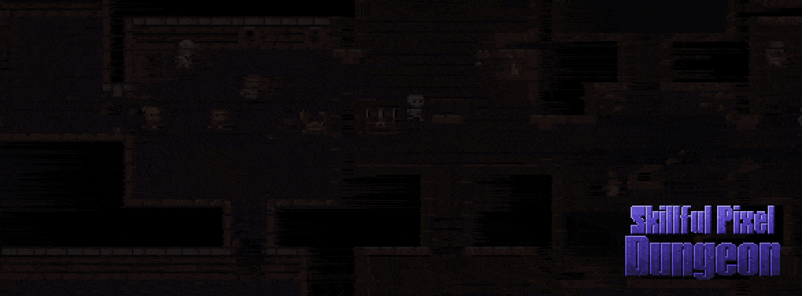

# Skillful Pixel Dungeon

Skillful Pixel Dungeon is a turn-based roguelike based on Pixel Dungeon. Choose from six hero classes, develop active and passive skills, and hire mercenaries to help you through the dungeon.

This repository contains the game source, assets, and build files for Android and desktop.

## Get the game

Buying the game on Steam supports the developer and lets you enjoy achievements and online gameplay support. You can also donate through the Android app.

[](https://store.steampowered.com/app/4696680/Skillful_Pixel_Dungeon/?utm_source=github&utm_medium=repository&utm_campaign=public_repo)
[](https://play.google.com/store/apps/details?id=com.bilboldev.pixeldungeonskills&utm_source=github&utm_medium=repository&utm_campaign=public_repo)
[](https://bilbolstack.com/games/skillful-pixel-dungeon?utm_source=github&utm_medium=repository&utm_campaign=public_repo)



## Project layout

- `src`: gameplay and engine code shared by both platforms
- `app`: Android manifest and build configuration
- `desktop`: desktop launcher and platform code
- `assets`: game art, audio, fonts, and translations
- `res`: Android resources

## Building

Requirements for both Android and desktop builds:

- JDK 17, with `JAVA_HOME` pointing to the JDK installation
- Android SDK Platform 36 and Android SDK Build-Tools, with the SDK licenses accepted
- `ANDROID_HOME` pointing to the SDK installation, or `sdk.dir` set in an ignored `local.properties` file

Use the included Gradle wrapper from the repository root. On Windows, use `gradlew.bat` instead of `./gradlew`. On Linux or macOS, run `chmod +x gradlew` first if needed.

Build the release APK and desktop ZIP:

```bash
./gradlew :app:assembleRelease :desktop:releaseDistZip
```

Both release builds are obfuscated. The outputs are:

- Android: `app/build/outputs/apk/release/app-release-unsigned.apk`
- Desktop: `desktop/build/distributions/SkillfulPixelDungeon-release.zip`

The release APK is unsigned; sign it with your own key before installing or distributing it. The desktop ZIP contains launch scripts and libraries and requires Java to run.

For development, build an installable debug APK or launch the desktop game:

```bash
./gradlew :app:assembleDebug
./gradlew :desktop:run
```

The debug APK is written to `app/build/outputs/apk/debug/app-debug.apk` and uses the local Android debug signing key.

## License

This project is distributed under the GNU GPL v3. See [LICENSE.txt](LICENSE.txt) for the full license text.
